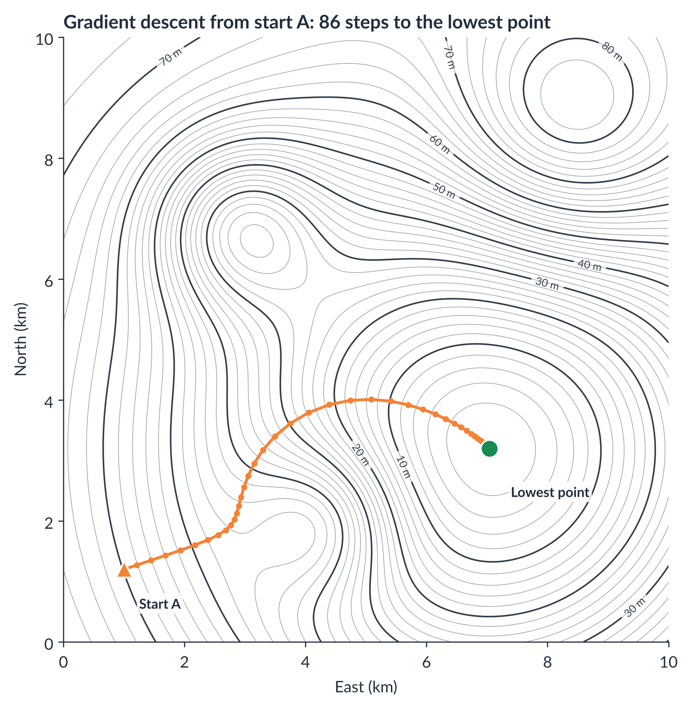

# An Introduction to Gradient Descent

[](https://colab.research.google.com/github/joedom99/introduction-to-gradient-descent/blob/main/introduction_to_gradient_descent.ipynb)


[](LICENSE)

Companion notebook for the Marketing Data Science article **"An Introduction to Gradient Descent: How Machines Learn by Walking Downhill"** on [blog.marketingdatascience.ai](https://blog.marketingdatascience.ai).



## What This Is

Gradient descent is the idea behind how many machine learning models, and nearly all modern neural networks, are trained. That includes the networks behind large language models. The idea is simple: start with a guess, find which direction makes the model less wrong, take a small step that way, and repeat.

This notebook explains it with a picture from the sport of orienteering. Gradient descent is like finding your way downhill at night with no map. You can't see the terrain, but you can feel which way the ground slopes under your feet.

It builds the idea in four stages:

- **A simulated landscape, drawn as a topographic map.** Slope, the gradient, the step rule, the learning rate, when to stop, and how a walk gets stuck in a local minimum.
- **A straight line fit to marketing data.** A small online shop's daily ad spend and revenue create a loss surface that reads like a topographic map. Gradient descent lands on the same line the textbook formula gives, and feature scaling decides how long that takes.
- **Stochastic gradient descent, momentum, and Adam.** The versions used on large data sets and in neural networks.
- **A small neural network and a budget decision.** A 25-parameter network learns the diminishing-returns curve a line can't follow, then recommends a daily ad budget. The notebook shows what the wrong model and an undertrained model each cost.

Everything is written from scratch in NumPy, including backpropagation. An optional last cell repeats the network in PyTorch.

All data is simulated with illustrative assumptions. A fixed random seed keeps the results reproducible.

## What's Inside

| File | Description |
|------|-------------|
| `introduction_to_gradient_descent.ipynb` | The notebook. Runs top to bottom in Google Colab using only preinstalled libraries. |
| `figures/` | Thirteen figures (fig01 to fig13) plus `hero_base.png`, a label-free map for a header image. 300 dpi PNG, Country Fried Creative brand style. |
| `tables/` | Seven tables as blog-ready PNG images, each with a CSV copy |
| `requirements.txt` | Libraries for running locally |

The notebook is organized into sixteen sections:

1. Setup (brand style plus settings cells: `T` terrain, `A` ad-spend data, `C` costs, `G` gradient descent, `B` batches, `M` momentum and Adam, `N` neural network)
2. The terrain
3. Slope: the one idea from calculus you need
4. From slope to gradient
5. Gradient descent
6. Step size and knowing when to stop
7. Getting stuck: local and global minimums
8. From terrain to data: fitting a line
9. Feature scaling: fixing a distorted map
10. Stochastic gradient descent
11. Momentum and Adam
12. A small neural network
13. From a trained model to a budget
14. Reference tables
15. Checking the results (36 checks: 8 math checks that should hold under any settings and 28 results of the default run)
16. Summary

### How to run it

Click the **Open in Colab** badge above and run all cells from top to bottom. It takes about a minute. Nothing needs to be installed.

To run it locally, you'll need Python 3.10 or later and Jupyter:

```bash
git clone https://github.com/joedom99/introduction-to-gradient-descent.git
cd introduction-to-gradient-descent
pip install -r requirements.txt notebook
jupyter notebook introduction_to_gradient_descent.ipynb
```

The notebook downloads the Lato font for its figures and falls back to the default font if it can't. The optional PyTorch cell skips itself if PyTorch isn't installed.

## Article Figure and Table Numbers

The file names follow the order the notebook was built in. The article adds three conceptual diagrams (Figures 1, 5, and 14) and numbers tables in reading order, so its numbering differs.

| Article | File |
|---------|------|
| Hero image (base layer) | `figures/hero_base.png` |
| Figure 2 | `figures/fig01_topo_map.png` |
| Figure 3 | `figures/fig02_slope_tangents.png` |
| Figure 4 | `figures/fig03_gradient_field.png` |
| Figure 6 | `figures/fig04_descent_path.png` |
| Figure 7 | `figures/fig05_step_sizes.png` |
| Figure 8 | `figures/fig06_stuck.png` |
| Figure 9 | `figures/fig07_line_fit.png` |
| Figure 10 | `figures/fig08_loss_surface.png` |
| Figure 11 | `figures/fig09_feature_scaling.png` |
| Figure 12 | `figures/fig10_sgd.png` |
| Figure 13 | `figures/fig11_optimizers.png` |
| Figure 15 | `figures/fig12_network_learning.png` |
| Figure 16 | `figures/fig13_budget.png` |
| Table 1 | `tables/table01_orienteering_glossary` |
| Table 2 | `tables/table07_stopping_rules` |
| Table 3 | `tables/table02_feature_scaling` |
| Table 4 | `tables/table03_budget_by_model` |
| Table 5 | `tables/table04_where_it_shows_up` |
| Table 6 | `tables/table05_troubleshooting` |
| Table 7 | `tables/table06_summary` |

## Key Results

With the default settings:

**On the terrain**

- **Gradient descent reaches the lowest point in 86 steps** from the first starting point. Each step starts at a right angle to the contour line it's standing on, and at this learning rate none goes uphill.
- **The learning rate decides whether it works.** Given the same 60 steps, a rate of 0.002 is still 5.4 km from the lowest point, 0.03 is within about 1.4 m of it, and 0.28 overshoots and is still 1.7 km away.
- **Where you start decides where you finish.** A second starting point ends in a depression 21 meters above the lowest point and stops there. About 27% of all starting points on the map do the same.
- **Momentum escapes the depression. Adam, at the default setting, does not.** No step rule is guaranteed to get out of a local minimum.

**On the marketing data**

- **Gradient descent matches the textbook formula.** Fitting daily revenue to ad spend, it lands on \$2.38 of revenue per extra ad dollar, within a hundredth of a cent of least squares.
- **Units matter.** With a learning rate suited to each set of units, the same fit takes 22 steps with ad spend standardized and 713 with spend in hundreds of dollars. In raw dollars it fails to converge in 10,000 steps and reports \$3.54 per ad dollar.
- **Stochastic gradient descent makes more progress per pass.** After 50 passes through the data, batch gradient descent (50 steps) has a typical miss of \$172. Mini-batch (1,600 steps) is at \$125.77 against a best possible \$125.76. A learning rate schedule cuts the run-to-run spread of single-row SGD from \$12.16 to \$1.08.
- **A small neural network learns the curve a line can't.** On the training days, typical miss falls from \$126 for the best straight line to \$61 for a 25-parameter network. On 1,000 fresh test days it is \$130 for the line and \$59 for the network, and the true curve itself misses by \$59. Backpropagation is checked against a finite-difference estimate for every parameter.
- **The wrong model, or an undertrained one, gives a confident wrong budget.** The truly best spend is \$257 a day. The straight line, trained perfectly, recommends \$500 and leaves about \$110 a day behind. The network after one pass through the data recommends \$391 and leaves about \$40 a day behind. Fully trained, it recommends \$263 and gives up 10 cents.
- **Random starting weights give slightly different models.** Ten trainings of the same network, differing only in their starting weights, recommend budgets from \$250 to \$263 a day.

The budget example assumes the simulated response curve is the truth and that ad spend causes the revenue. With real data that has to be established separately, and a randomized incrementality test is one strong way to do it. Passing the notebook's checks means it produced the examples it describes. It doesn't prove the same thing happens with other data.

## Related Articles

- [Objective Functions for Marketers: How Models Decide What "Best" Means](https://blog.marketingdatascience.ai/objective-functions-for-marketers-how-models-decide-what-best-means-b737f1705d6b)
- [Loss Functions for Marketers: How Models Decide What "Wrong" Means](https://blog.marketingdatascience.ai/loss-functions-for-marketers-how-models-decide-what-wrong-means-1e66a55bc825)
- [An Introduction to Linear Algebra: The Math I Slept Through in College That Now Powers AI](https://blog.marketingdatascience.ai/an-introduction-to-linear-algebra-the-math-i-slept-through-in-college-that-now-powers-ai-c4831f688496)
- [A Marketer's Guide to Calculus](https://blog.marketingdatascience.ai/a-marketers-guide-to-calculus-9ced95758447)
- [Marketing with Neural Networks: What They Are and How to Use Them](https://blog.marketingdatascience.ai/marketing-with-neural-networks-what-they-are-and-how-to-use-them-3e0114771c40)
- [Neural Networks Explained from First Principles in R](https://blog.marketingdatascience.ai/neural-networks-explained-from-first-principles-in-r-795bc158cf37)
- [Linear Regression: The Classic Machine Learning Algorithm You Need to Know](https://blog.marketingdatascience.ai/linear-regression-the-classic-machine-learning-algorithm-you-need-to-know-1fe0b48b06a3)
- [Is Your Marketing Model Too Accurate?](https://blog.marketingdatascience.ai/is-your-marketing-model-too-accurate-5076f5163326)
- [Business Lessons from the Sport of Orienteering](https://thecitizen.com/2023/04/11/business-lessons-from-the-sport-of-orienteering/)

## License

This project is licensed under the MIT License. See [LICENSE](LICENSE) for details.

## Author

**Joe Domaleski** is the founder of [Country Fried Creative](https://countryfriedcreative.com), a digital marketing agency in Peachtree City, Georgia. He holds an MBA from Georgia State University and an MS in Analytics from Georgia Tech, and writes about marketing and data science at [blog.marketingdatascience.ai](https://blog.marketingdatascience.ai).
